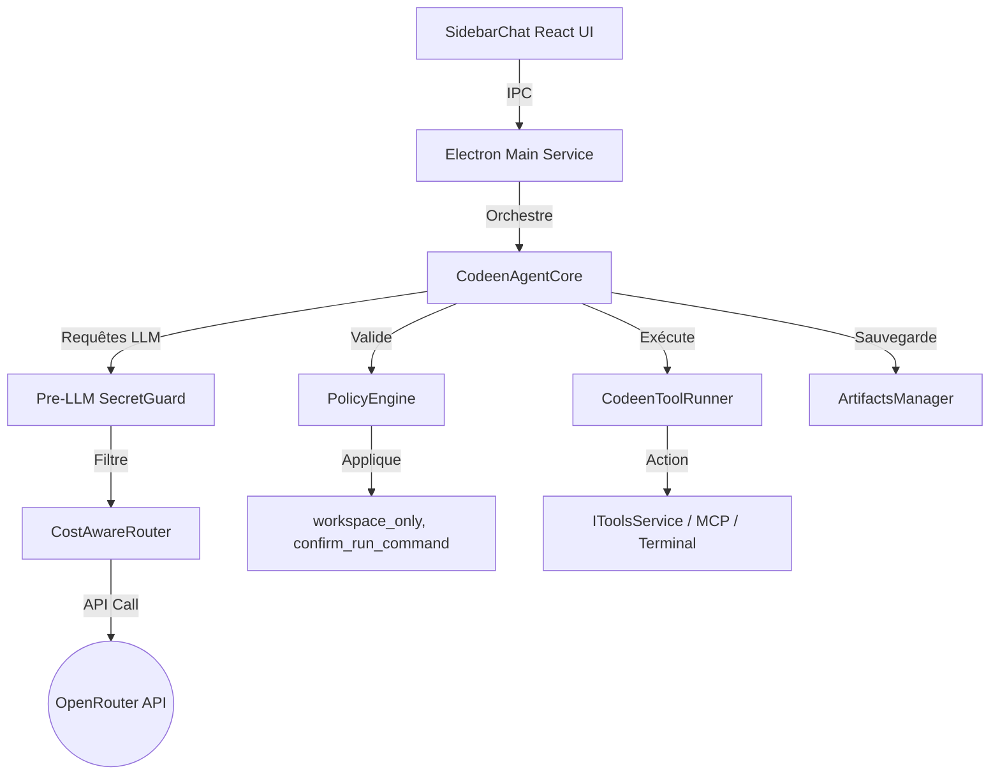

# CODEEN — Antigravity-Inspired Implementation Plan

Ce plan décrit en détail la stratégie technique d'analyse, d'adaptation et de déploiement des concepts du SDK Antigravity pour enrichir et structurer l'architecture de **Codeen** (fork de Void) sans introduire de dépendance runtime externe et en conservant **OpenRouter** comme routeur LLM central.

---

## 1. Résumé exécutif

L'objectif de ce plan est de transformer **Codeen** d'un simple éditeur assisté par chat IA en un **IDE agentique autonome, sécurisé et hautement optimisé en coûts**. 

En nous inspirant des abstractions du **SDK Google Antigravity** (notamment son cycle de vie d'agent, son système de politiques de sécurité déclaratives en couches, ses hooks d'interception et ses tâches asynchrones récurrentes), nous proposons une refonte modulaire en TypeScript pour l'environnement Electron de Codeen.

**Axes fondamentaux :**
* **Zéro Dépendance Runtime Antigravity** : Aucun binaire Google compilé ni bibliothèque Python ne sera installé en production. Tout le code sera écrit en TypeScript natif.
* **OpenRouter au cœur du routage** : Nous tirons parti d'OpenRouter pour le calcul des coûts, la gestion des contextes larges, le routage intelligent entre modèles d'explications économiques et modèles de raisonnement coûteux, et le fallback automatique.
* **Sécurité Fail-Closed** : Intégration de politiques strictes de sécurité pour l'accès aux fichiers et l'exécution dans le terminal, empêchant l'agent de s'échapper du workspace.
* **Extensibilité par Skills et Artifacts** : Modularisation des capacités de l'agent pour réduire l'empreinte des tokens tout en le spécialisant dans des tâches spécifiques.
* **Pre-LLM Secret Guard** : Filtrage et masquage local des données sensibles avant envoi pour protéger les secrets du projet.

---

## 2. Cartographie du workspace

L'espace de travail est structuré de la manière suivante :

```text
workspace/
├── void/                    # Code source principal de l'IDE Codeen (en cours de migration de marque)
└── antigravity-sdk-python/  # Code source du SDK Antigravity (Python, Apache-2.0, utilisé comme inspiration)
```

### Détail des composants du workspace

1. **`void` (futur Codeen)**
   * **Langage principal** : TypeScript (95%), CSS (3%), HTML (2%)
   * **Frameworks/Environnement** : VS Code Fork, Electron, React (Tailwind pour les vues contrib)
   * **Rôle** : L'IDE lui-même, gérant l'interface utilisateur, la communication avec les LLM (IPC et services Electron main), et les outils d'édition.
   * **Licence** : Apache 2.0 (Glass Devtools, Inc.)
   * **Réutilisation** : Base de code active à modifier incrémentalement.

2. **`antigravity-sdk-python`**
   * **Langage principal** : Python (100%)
   * **Frameworks** : Pydantic v2, asyncio
   * **Rôle** : SDK de référence Google décrivant les mécanismes agentiques avancés (Policies, HookRunner, ToolRunner, Conversation stateful).
   * **Licence** : Apache 2.0
   * **Réutilisation** : **Inspiration conceptuelle uniquement (Catégorie C)**. Aucun code Python ne sera intégré. Les algorithmes de sécurisation de chemin et de priorisation de politique seront traduits et réimplémentés de manière native en TypeScript.

---

## 3. Règle importante sur la réutilisation du code

Chaque composant du SDK Antigravity a été classé selon les règles de réutilisation :

### Catégorie A — Réutilisable directement (avec traduction et adaptation de type)
* **L'algorithme de confinement de workspace** (`policy.py` L441-536) : La validation robuste `is_path_in_workspace` (incluant la résolution canonique sécurisée pour se prémunir contre les symlinks, junctions et casefolding) sera transcrite directement en TypeScript.
* **Le modèle d'évaluation par priorité spécifique** (`policy.py` L542-591) : La logique de préséance des décisions et de court-circuit.

### Catégorie B — Réimplémentation recommandée (Concepts reconstruits de zéro)
* **HookRunner et cycle de vie d'interception** : Création d'une structure d'interception asynchrone légère en TypeScript.
* **Moteur de politiques (Policies)** : Un système de politiques déclaratives compilées localement dans Codeen.
* **Artifacts** : Rendu et persistance des fichiers markdown de suivi et plan d'exécution de l'agent.
* **Context Compaction** : Résumés automatiques de l'historique de chat en arrière-plan via des modèles rapides OpenRouter.

### Catégorie C — Inspiration uniquement
* **Conversation stateful** : Gérée nativement par `chatThreadService.ts`, mais que nous allons enrichir conceptuellement avec le suivi des turn counts et le streaming d'événements de pensée.
* **Triggers** : Tâches asynchrones planifiées (Scheduler TypeScript basique).

### Catégorie D — À ne pas intégrer
* **Connection et transport réseau** (`connections/`) : Trop lié à l'infrastructure runtime binaire externe et à l'API directe Gemini.
* **Interprétation Python et binaires natifs tiers** : Pour préserver la légèreté de Codeen.

---

## 4. Analyse de l'architecture actuelle de Codeen/Void

L'architecture actuelle de Void possède les fondations suivantes :

* **Boucle agentique et conversations** :
  * [chatThreadService.ts](file:///e:/dev/void/src/vs/workbench/contrib/void/browser/chatThreadService.ts) : Gère le cycle de vie des conversations, l'historique des messages, les états des flux et la coordination avec le moteur de complétion.
* **Système de tool calling** :
  * [toolsService.ts](file:///e:/dev/void/src/vs/workbench/contrib/void/browser/toolsService.ts) : Implémente l'exécution des outils natifs (`view_file`, `write_to_file`, `grep_search`, `run_command`, etc.).
  * [toolsServiceTypes.ts](file:///e:/dev/void/src/vs/workbench/contrib/void/common/toolsServiceTypes.ts) : Définit les types d'approbation (`ToolApprovalType`), les signatures des outils, et les schémas de paramètres.
* **Intégration LLM et routeurs** :
  * [sendLLMMessage.impl.ts](file:///e:/dev/void/src/vs/workbench/contrib/void/electron-main/llmMessage/sendLLMMessage.impl.ts) : Gère la négociation effective des requêtes LLM avec les API distantes (dont OpenRouter, Anthropic, Gemini, OpenAI).
  * [sendLLMMessageService.ts](file:///e:/dev/void/src/vs/workbench/contrib/void/common/sendLLMMessageService.ts) : Interface IPC pour la transmission des requêtes du thread de rendu à Electron Main.
  * [modelCapabilities.ts](file:///e:/dev/void/src/vs/workbench/contrib/void/common/modelCapabilities.ts) : Cartographie les aptitudes des modèles (comme le support de la réflexion/reasoning ou du tool calling).
* **Gestion du contexte et des coûts** :
  * [contextBudgetService.ts](file:///e:/dev/void/src/vs/workbench/contrib/void/browser/contextBudgetService.ts) : Mesure la taille des fenêtres de contexte, gère les limites de tokens estimées par jour et par session.
  * [contextGatheringService.ts](file:///e:/dev/void/src/vs/workbench/contrib/void/browser/contextGatheringService.ts) : Collecte les fichiers ouverts et les sélections pour les envoyer dans le prompt du LLM.
  * [prompts.ts](file:///e:/dev/void/src/vs/workbench/contrib/void/common/prompt/prompts.ts) : Contient les instructions système par défaut pour les différents modes (chat, agent, génération de commit).
* **Exécution de commandes** :
  * [terminalToolService.ts](file:///e:/dev/void/src/vs/workbench/contrib/void/browser/terminalToolService.ts) : Gère l'exécution des commandes dans les terminaux persistants de VS Code.
* **Système d'approbation et streaming** :
  * [SidebarChat.tsx](file:///e:/dev/void/src/vs/workbench/contrib/void/browser/react/src/sidebar-tsx/SidebarChat.tsx) : UI d'approbation manuelle (Accept/Reject) pour l'exécution d'outils et de diffs.
* **Model Context Protocol (MCP)** :
  * Le projet possède une intégration MCP pour charger des serveurs MCP externes et mapper leurs outils de manière dynamique.

---

## 5. Analyse du SDK Antigravity

Le SDK Antigravity fournit un ensemble de classes et de fichiers sources clés :

* **`google/antigravity/agent.py` (Agent)** :
  * Sert de gestionnaire de contexte haut niveau qui masque la plomberie d'initialisation (HookRunner, ToolRunner, ConnectionStrategy).
* **`google/antigravity/conversation/conversation.py` (Conversation)** :
  * Session conversationnelle stateful qui accumule l'historique et suit le nombre de tours (`turn_count`). Il s'appuie sur un flux d'étapes (`Step`) et d'événements de streaming typés pour distinguer le texte conversationnel, les pensées/raisonnements (`thoughts`), et les appels d'outils (`tool_calls`).
* **`google/antigravity/hooks/policy.py` (Policies & Confinement)** :
  * Utilise un modèle de priorité stricte basé sur la spécificité pour trancher sur l'exécution d'un outil :
    `Specific Deny > Specific Ask > Specific Allow > Prefix Deny > Prefix Ask > Prefix Allow > Wildcard Deny > Wildcard Ask > Wildcard Allow`
  * Implémente la règle `workspace_only` en calculant de manière canonique et sécurisée le chemin cible via `Path.resolve()` pour interdire tout accès en dehors du workspace (évite les attaques par traversée de répertoires ou liens symboliques).
* **`google/antigravity/hooks/hook_runner.py` (Hooks d'interception)** :
  * Fournit des points d'interception asynchrones (`pre_tool_call_decide_hooks`, `post_tool_call_hooks`) permettant à des modules externes de se greffer sur le cycle de vie de l'agent.
* **`google/antigravity/triggers/trigger_runner.py` (Déclencheurs)** :
  * Système d'exécution en tâche de fond (`every(seconds)`) poussant des requêtes asynchrones.

---

## 6. Concepts à réimplémenter

### 6.1 Agent Core
Création du noyau agentique sous `src/vs/workbench/contrib/void/common/agent/agentCore.ts`. Ce service stockera l'état de la tâche courante (initialisée, en cours d'exécution, en attente d'approbation utilisateur, interrompue, en erreur), le plan de travail actuel, les checkpoints d'historique et coordonnera les étapes de la boucle de réflexion de l'agent. **L'intégration dans le chat principal se fera de manière incrémentale et prudente pour ne pas rompre la logique existante.**

### 6.2 Tool Runner
Création de `src/vs/workbench/contrib/void/common/agent/toolRunner.ts` pour encapsuler l'exécution de tous les outils (natifs et MCP). Le runner validera les arguments de l'outil via les politiques de sécurité avant toute exécution, gérera la journalisation fine (temps d'exécution, statut), formatera de façon compacte le retour pour le réinjecter dans le contexte LLM, et lèvera une alerte de sécurité ou une erreur propre en cas de violation.

### 6.3 Policies
Implémentation d'un moteur de règles déclaratives sous `src/vs/workbench/contrib/void/common/agent/policyEngine.ts` gérant :
* `workspace_only` : Bloque tout accès en lecture/écriture hors du workspace en utilisant la méthode de validation de chemin sécurisée.
* `confirm_run_command` : Intercepte les lancements de terminaux pour forcer une validation manuelle.
* `deny_destructive` : Détecte des motifs dangereux (ex: `rm -rf`, `format`, `drop table`).
Le moteur fonctionne selon le principe du **Fail-Closed** : en cas d'incertitude ou d'erreur d'interprétation d'une règle, l'action est interdite par défaut.

### 6.4 Hooks
Mise en place d'un système de hooks internes :
* `beforeLLMCall` : Permet d'injecter ou d'adapter dynamiquement les règles de prompt.
* `beforeToolCall` / `afterToolCall` : Branche le moteur de politiques et gère le formatage.
* `onToolError` : Tente une remédiation ou demande de l'aide en cas d'erreur bloquante.

### 6.5 Skills
Support du dossier `.codeen/skills/` à la racine du projet. L'agent détecte dynamiquement les compétences pertinentes pour le projet via un scan au démarrage (ex: détection d'un framework particulier) et n'injecte dans le prompt que les instructions de la skill sélectionnée pour économiser les tokens.

### 6.6 Artifacts
Les artifacts sont des documents structurés produits par l'agent (ex: plan d'exécution, rapports de tests). Ils seront écrits sous `.codeen/artifacts/` et l'interface React (`ArtifactsViewer.tsx`) offrira un affichage riche en onglets et sous forme de carrousels pour permettre à l'utilisateur de suivre l'avancement et d'éditer manuellement les plans si nécessaire.

### 6.7 Context Compaction
Implémentation d'une routine de compression sous `src/vs/workbench/contrib/void/common/agent/contextManager.ts`. Dès que l'historique dépasse 75% de la limite allouée par le budget de contexte, un appel LLM asynchrone ultra-économique (ex: `gemini-2.5-flash`) résume les anciens tours et remplace le bruit par une synthèse des décisions et actions passées.

### 6.8 Context Budget Manager
Un gestionnaire intelligent attribue des quotas stricts de jetons aux différentes parties du prompt en fonction des capacités du modèle sélectionné (system instructions, historique résumé, fichiers actifs, outils MCP).

### 6.9 Cost-Aware Model Routing
OpenRouter reste le moteur central. Le système évalue le prompt et route :
* Les tâches simples de recherche vers un modèle économique (`gpt-4o-mini`, `gemini-2.5-flash`).
* Les tâches complexes d'architecture et d'édition de code vers des modèles puissants (`claude-3-5-sonnet`, `deepseek-coder`).
* Les phases nécessitant une forte planification vers un modèle de raisonnement (`o3-mini`, `deepseek-reasoner`).

### 6.10 Agent Manager UI
Une vue React intégrée au panneau de discussion affichera l'état de la tâche courante ( TODO / En cours / Terminé), le coût accumulé de la session en cents de dollar, et offrira des commandes d'arrêt d'urgence de la boucle de réflexion.

### 6.11 Pre-LLM Secret Guard / Pipeline de masquage
Création d'un pipeline de filtrage local `src/vs/workbench/contrib/void/common/agent/secretGuard.ts` qui intercepte tout le contexte généré avant son expédition vers OpenRouter.
Il utilise des expressions régulières locales pour détecter et masquer :
* Les clés d'API (OpenRouter, OpenAI, Anthropic, Google Gemini, Supabase, Firebase, etc.).
* Les identifiants, JWT, en-têtes `Authorization: Bearer <token>`.
* Les contenus sensibles des fichiers `.env` (mots de passe de base de données, secrets cryptographiques).
* Les clés privées (PEM, RSA).
Toute chaîne suspecte est remplacée par un jeton de masquage (ex: `[MASKED_API_KEY]`) préservant l'intégrité fonctionnelle du prompt sans exposer de secrets aux LLM tiers.

---

## 7. Concepts à éviter
* **Runtime binaire propriétaire Google** : Tout sera compilé au sein de l'environnement TypeScript de VS Code/Electron.
* **Interprétation asynchrone Python** : Pas de code Python en production pour simplifier la distribution de l'IDE.

---

## 8. Matrice comparative

| Concept | Présent dans Codeen/Void ? | Présent dans Antigravity SDK ? | État actuel Codeen | Ce qu'Antigravity apporte | Réutilisation possible | Recommandation | Priorité |
| :--- | :---: | :---: | :--- | :--- | :--- | :--- | :---: |
| **Agent Core** | Partiel | Oui | Logique diffuse dans `chatThreadService` | Abstraction centralisée de l'état agentique | Structure conceptuelle | Centraliser dans un `CodeenAgentCore` | **P0** |
| **Tool Runner** | Oui | Oui | Exécution directe dans `toolsService` | Cycle de validation homogène avec hooks | Concept | Séparer la validation de l'exécution | **P0** |
| **Policies** | Non | Oui | Aucun filtrage (sauf choix globaux manuels) | Filtrage déclaratif par règles et priorité | Traduction TypeScript | Créer un moteur de règles (`workspace_only`, etc.) | **P0** |
| **Hooks** | Non | Oui | Aucun hook d'interception | Interception de cycle de vie (LLM, Outils) | Concept simplifié | Ajouter des hooks autour de l'exécution | **P1** |
| **Triggers** | Non | Oui | Aucun automatisme récurrent | Tâches de fond avec injection d'instructions | Concept | Implémenter un scheduler de triggers simple | **P2** |
| **Skills** | Non | Oui | Chargement global via prompts systèmes | Chargement ciblé de règles par framework | Structure markdown | Intégrer un chargeur de `.codeen/skills` | **P1** |
| **Artifacts** | Non | Oui | Pas de génération formalisée d'artifacts | Documents structurés persistés | Structure markdown | Rendu d'artifacts markdown éditables | **P1** |
| **Context Compaction** | Non | Non | Aucun résumé automatique | Aucun (historique linéaire) | N/A | Synthétiser l'historique via un modèle rapide | **P1** |
| **Context Budget** | Partiel | Non | Indication simple de jetons consommés | Aucun | N/A | Distribution active des limites selon le modèle | **P1** |
| **Model Routing** | Non | Non | Sélection manuelle du modèle unique | Aucun | N/A | Routage dynamique intelligent via OpenRouter | **P0** |

---

## 9. Architecture cible Codeen

Le diagramme ci-dessous illustre le flux d'orchestration cible :



---

## 10. Plan de déploiement par phases

### Phase 1 — Types de base Agent Core
* **Objectif** : Poser les interfaces et les structures de types pour l'agent.
* **Nouveaux fichiers** :
  * `src/vs/workbench/contrib/void/common/agent/agentTypes.ts`
  * `src/vs/workbench/contrib/void/common/agent/agentCore.ts` (vide, stub basique)
* **Risques** : Aucun. C'est une phase purement déclarative sans impact sur le chat existant.
* **Validation** : Compilation du projet sans erreur TypeScript.

### Phase 2 — Policy Engine & Confinement (Sécurité)
* **Objectif** : Implémenter le moteur de règles de sécurité et de confinement.
* **Nouveaux fichiers** :
  * `src/vs/workbench/contrib/void/common/agent/policyEngine.ts` (moteur pur et testable de validation).
  * `src/vs/workbench/contrib/void/common/agent/toolRunner.ts` (stub intermédiaire).
* **Validation** : Rédaction de tests unitaires poussés (Phase 2.5) simulant les cas de traversées de chemin, symlinks et chemins inexistants.

### Phase 3 — Branchement Sécurisé & Masquage (Secret Guard)
* **Objectif** : Intercepter l'exécution des outils réels et masquer les secrets.
* **Nouveaux fichiers** :
  * `src/vs/workbench/contrib/void/common/agent/secretGuard.ts` (filtre regex local).
* **Modification** :
  * Brancher le `policyEngine` dans [toolsService.ts](file:///e:/dev/void/src/vs/workbench/contrib/void/browser/toolsService.ts) pour interdire d'office toute écriture hors workspace et filtrer les lancements de terminaux.
  * Intercepter le prompt final avant expédition réseau pour y passer le `SecretGuard`.

### Phase 4 — Intégration Progressive Agent Core
* **Objectif** : Brancher la logique de boucle agentique multi-étapes.
* **Modification** : Brancher le traitement dans [chatThreadService.ts](file:///e:/dev/void/src/vs/workbench/contrib/void/browser/chatThreadService.ts) de façon graduelle uniquement lorsque le mode `agent` est explicitement sollicité par l'utilisateur.

### Phase 5 — Context Compaction & Budget Manager
* **Objectif** : Optimiser l'usage et les coûts en jetons.
* **Nouveaux fichiers** :
  * `src/vs/workbench/contrib/void/common/agent/contextManager.ts`
* **Modification** : [contextBudgetService.ts](file:///e:/dev/void/src/vs/workbench/contrib/void/browser/contextBudgetService.ts).
* **Validation** : Vérifier que l'historique est résumé automatiquement après 5 tours d'outils lorsque la mémoire s'approche de la limite.
* **Complexité** : Moyenne-Haute.

### Phase 6 — Skills System
* **Objectif** : Permettre à l'utilisateur de configurer des instructions par workspace.
* **Nouveaux fichiers** :
  * `src/vs/workbench/contrib/void/common/agent/skillsLoader.ts`
* **Validation** : Chargement correct d'une skill `.codeen/skills/laravel-refactor/SKILL.md` au démarrage et injection appropriée dans le prompt.
* **Complexité** : Basse.

### Phase 7 — Artifacts System
* **Objectif** : Visualisation des livrables de l'agent.
* **Nouveaux fichiers** :
  * `src/vs/workbench/contrib/void/common/agent/artifactsManager.ts`
  * `src/vs/workbench/contrib/void/browser/react/src/sidebar-tsx/ArtifactsViewer.tsx`
* **Validation** : Un fichier markdown d'artifact généré par l'agent s'ouvre dans un onglet dédié au lieu de s'afficher comme simple bloc de texte dans le chat.
* **Complexité** : Moyenne.

### Phase 8 — OpenRouter Cost-Aware Routing & Limites
* **Objectif** : Router dynamiquement les prompts vers les modèles les plus rentables et imposer les limites financières.
* **Nouveaux fichiers** :
  * `src/vs/workbench/contrib/void/common/agent/router.ts`
* **Modification** : [sendLLMMessage.impl.ts](file:///e:/dev/void/src/vs/workbench/contrib/void/electron-main/llmMessage/sendLLMMessage.impl.ts).
* **Validation** : Les requêtes simples de recherche sont traitées par un modèle léger, tandis que l'application de modifications lourdes passe par un modèle complexe.
* **Complexité** : Moyenne-Haute.

### Phase 9 — Agent Manager UI, Sandbox & Stabilisation
* **Objectif** : Finalisation, interface utilisateur, tests d'intégration complets et documentation.

---

## 11. Micro-étapes techniques (Phase 1 & 2)

### Étape 1.1 : Types de base (`agentTypes.ts`)
Créer l'interface pour `AgentStep` et `AgentState` :
```typescript
export type AgentState = 'IDLE' | 'PLANNING' | 'EXECUTING_TOOL' | 'AWAITING_APPROVAL' | 'ERROR';

export interface AgentStep {
    stepId: string;
    thought: string;
    toolCall?: {
        name: string;
        args: Record<string, any>;
    };
    toolResult?: {
        success: boolean;
        output: string;
    };
    costInCents?: number;
    timestamp: number;
}
```

### Étape 2.1 : Confinement de chemin sécurisé gérant les fichiers inexistants
```typescript
import * as path from 'path';
import * as fs from 'fs';

/**
 * Valide de façon sécurisée (Fail-Closed) si un chemin cible se trouve dans le workspace.
 * Gère les fichiers/dossiers existants ainsi que les fichiers inexistants (à créer).
 */
export function isPathInWorkspace(targetPath: string, workspacePath: string): boolean {
    try {
        const resolvedTarget = path.resolve(targetPath);
        
        // Détermination du plus proche parent existant pour résoudre les symlinks/junctions
        let currentPath = resolvedTarget;
        while (!fs.existsSync(currentPath)) {
            const parent = path.dirname(currentPath);
            if (parent === currentPath) {
                // Atteint la racine sans trouver de dossier existant
                break;
            }
            currentPath = parent;
        }

        // Si aucun parent n'existe (très improbable car la racine existe toujours), fail-closed
        if (!fs.existsSync(currentPath)) {
            return false;
        }

        // Résolution canonique (suit les liens symboliques et jonctions)
        const canonicalParent = fs.realpathSync(currentPath);
        const canonicalWorkspace = fs.realpathSync(path.resolve(workspacePath));

        // Résolution du reste du chemin qui n'existe pas encore (calcul purement lexical sur le chemin canonique)
        const relativePart = path.relative(currentPath, resolvedTarget);
        const canonicalTarget = path.resolve(canonicalParent, relativePart);

        // Détection de la casse système
        const isCaseInsensitive = process.platform === 'win32' || process.platform === 'darwin';
        const tPath = isCaseInsensitive ? canonicalTarget.toLowerCase() : canonicalTarget;
        const wPath = isCaseInsensitive ? canonicalWorkspace.toLowerCase() : canonicalWorkspace;

        // Confinement strict
        return tPath.startsWith(wPath + path.sep) || tPath === wPath;
    } catch {
        return false; // Fail-closed par défaut
    }
}
```

### Étape 2.2 : Moteur de politiques (`policyEngine.ts`)
```typescript
export interface Policy {
    name: string;
    tool: string;
    decision: 'APPROVE' | 'DENY' | 'ASK_USER';
    when?: (args: Record<string, any>) => boolean;
}

export class PolicyEngine {
    constructor(private readonly policies: Policy[]) {}

    evaluate(toolName: string, args: Record<string, any>): 'APPROVE' | 'DENY' | 'ASK_USER' {
        // Logique de priorité Fail-Closed
        // Spécifique Deny > Spécifique Ask > Spécifique Allow
        // ...
        return 'APPROVE';
    }
}
```

---

## 12. Risques techniques

1. **Explosion des coûts OpenRouter** : Une boucle infinie où l'agent réessaye un outil défectueux peut rapidement coûter cher.
   * *Atténuation* : Plafonner les tours consécutifs d'outils à 5 sans interaction humaine. Imposer des limites dures (voir Section 14).
2. **Latence d'évaluation** : Les vérifications de politiques sur les fichiers ne doivent pas impacter l'expérience d'écriture dans l'IDE.
   * *Atténuation* : Les politiques de confinement s'exécutent de façon purement synchrone et locale en mémoire (pas d'appels réseau ou LLM intermédiaires).
3. **Cas de faux-positifs dans la détection hors-workspace** : Des projets utilisant des liens symboliques vers des dossiers partagés légitimes (ex: `node_modules` global ou dossiers de build) peuvent se retrouver bloqués.
   * *Atténuation* : Permettre de configurer des chemins additionnels autorisés dans `.codeen/config.json`.

---

## 13. Tests recommandés
* **Test unitaire de traversée de répertoires** : Tenter d'accéder à `../../etc/passwd` ou des fichiers système Windows depuis le confinement et s'assurer que `isPathInWorkspace` renvoie systématiquement `false`.
* **Test de création de fichiers inexistants** : Valider que la création de `e:\dev\void\src\new_folder\file.ts` est approuvée, tandis que `e:\dev\new_folder\file.ts` (hors workspace) est bloquée.
* **Test de priorité des décisions** : Valider qu'un `Specific Deny` l'emporte sur un `Wildcard Allow`.
* **Test de non-régression de l'historique** : Valider que le chat standard fonctionne sans l'interférence de l'Agent Core.

---

## 14. Décisions à valider avant implémentation

> [!IMPORTANT]
> 1. **Comportement par défaut (Validé)** : 
>    * Mode restrictive par défaut (Fail-Closed).
>    * `run_command` exige systématiquement l'approbation de l'utilisateur.
>    * Tout accès en écriture ou lecture en dehors du workspace (ou répertoires explicitement autorisés) est bloqué.
> 2. **Contrôle et plafonds de coûts LLM (Validé)** :
>    * *Avertissement visuel* : Dès que la session atteint **0.20 $**.
>    * *Demande de confirmation* : Dès que la session atteint **0.50 $**.
>    * *Hard Stop* : Arrêt automatique à **1.00 $** (sauf modification volontaire par l'utilisateur).

---

## 15. Conclusion & Recommandation finale

### Recommandation immédiate
Nous recommandons de **lancer le développement de la Phase 1 et de la Phase 2** selon la séquence progressive définie :

**Fichiers à créer et modifier en premier :**
1. Création de `agentTypes.ts` et du stub de `agentCore.ts` (sans impacter le chat).
2. Création de [policyEngine.ts](file:///e:/dev/void/src/vs/workbench/contrib/void/common/agent/policyEngine.ts) avec l'algorithme `isPathInWorkspace` robuste.
3. Rédaction et exécution de la suite de tests unitaires pour la validation des chemins.
4. Branchement du `policyEngine` dans [toolsService.ts](file:///e:/dev/void/src/vs/workbench/contrib/void/browser/toolsService.ts) pour interdire toute écriture/exécution sensible.

*Aucun fichier source existant n'a été altéré dans cette étape de planification.*
