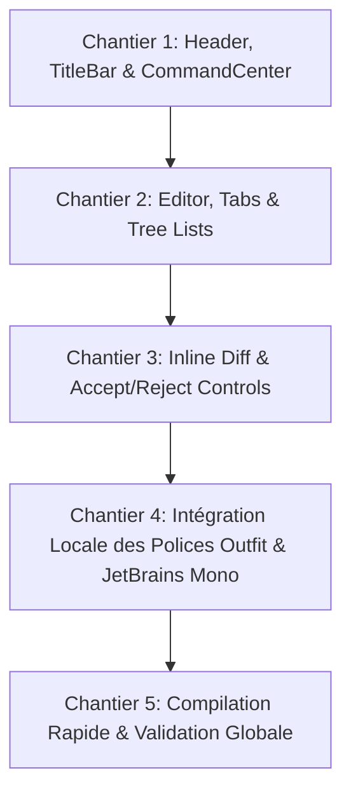

# Plan d'Architecture & Implémentation : Transformation Native Codeen

## 1. Découpage en 5 Chantiers Majeurs

---

## 2. Détail Technique des Chantiers

### Chantier 1 : Header, TitleBar, Command Center & Branding
- **Logo Codeen SVG** : Remplacement de `src/vs/workbench/browser/media/code-icon.svg` par le monogramme C vectoriel de marque Codeen avec dégradé cyan/bleu électrique (`#2563FF` vers `#00D1FF`) ou néon.
- **TitleBar Background** : Mise à jour de `TITLE_BAR_ACTIVE_BACKGROUND` et `TITLE_BAR_INACTIVE_BACKGROUND` sur `#0B0D11` dans `src/vs/workbench/common/theme.ts`.
- **TitleBar Border** : Bordure discrète `#20242D`.
- **Command Center** : Fond `#12151B`, bordure `#20242D`, bordure active `#45f99c`.

### Chantier 2 : Éditeur Monaco, Onglets & Arborescence (File Explorer)
- **Editor Background** : Mise à jour de `editor.background` sur `#0B0D11` dans `dark_vs.json`, `dark_modern.json` et `workbenchThemeService.ts`.
- **Tabs** :
  - `tab.activeBackground`: `#0B0D11`
  - `tab.activeBorderTop`: `#45f99c`
  - `tab.inactiveBackground`: `#12151B`
  - `editorGroupHeader.tabsBackground`: `#12151B`
  - `editorGroupHeader.tabsBorder`: `#20242D`
- **List & Tree Selections** :
  - `list.activeSelectionBackground`: `rgba(69, 249, 156, 0.14)`
  - `list.activeSelectionForeground`: `#45f99c`
  - `list.inactiveSelectionBackground`: `rgba(255, 255, 255, 0.04)`
  - `list.focusHighlightForeground`: `#45f99c`
  - `list.highlightForeground`: `#45f99c`
- **Panel & Terminal** :
  - `panel.background`: `#0B0D11`
  - `panelTitle.activeBorder`: `#45f99c`
  - `terminal.background`: `#0B0D11`
  - `terminalCursor.foreground`: `#45f99c`

### Chantier 3 : Inline Diff & Contrôles Accept / Reject
- **Widget Fast Apply & Diff Zone** :
  - Harmonisation des boutons dans `VoidCommandBar.tsx` et `QuickEditChat.tsx`.
  - Bouton Accept : Vert émeraude `#00DC82`, texte sombre `#00391d`, hover éclatant.
  - Bouton Reject : Fond sombre `#1F1418` avec liseré bordeaux `#4A1B22` et texte clair.
- **Diff Editor** :
  - Couleurs d'insertion vertes subtiles (`rgba(69, 249, 156, 0.15)`).
  - Couleurs de suppression rouges sombres (`rgba(248, 113, 113, 0.15)`).

### Chantier 4 : Embarquement Local des Polices (Outfit & JetBrains Mono)
- Vérification ou inclusion des fichiers fontes WOFF2 / TTF dans `src/vs/base/browser/ui/fonts/` ou `src/vs/workbench/browser/media/fonts/`.
- Définition de `@font-face` dans `src/vs/workbench/browser/media/style.css`.
- Application d'Outfit dans la pile CSS principale de l'interface workbench.
- Définition de `JetBrains Mono` par défaut dans les options de Monaco Editor.

### Chantier 5 : Compilation & Validation
- Validation de la chaîne de compilation rapide esbuild (`transpile-client-esbuild` en ~35 secondes).
- Recompilation React via `npm run buildreact`.
- Contrôle des variables dans `out/`.
